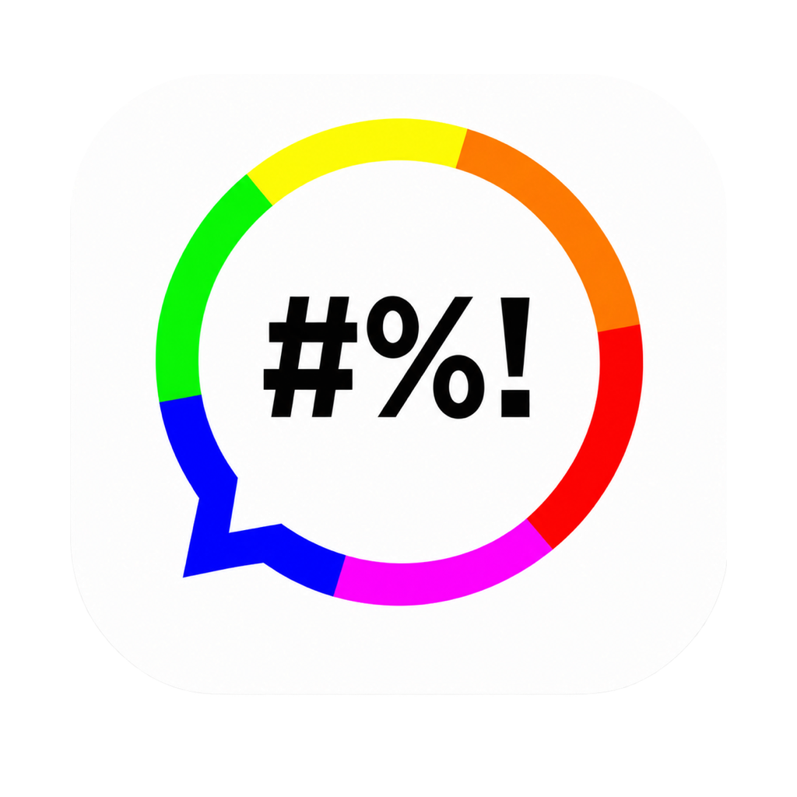

<p align="center">
  
</p>

# Fucking Advice for macOS

Fucking Advice is a native menu-bar app for macOS 15 and newer. It fetches one random phrase when the host process starts, caches the result, and shows the same cached phrase in a desktop text overlay and WidgetKit widgets. **Refresh Now** starts a manual request. An optional in-process timer can refresh the advice every 5 minutes to 24 hours.

The timer is disabled by default and runs only while the menu-bar process is alive. The app preserves Unicode text and profanity returned by `https://fucking-great-advice.ru/api/random`. It contains no analytics, accounts, background daemon, audio playback, or wallpaper modification.

## Components

| Component | Responsibility |
|---|---|
| SwiftUI/AppKit host | Menu bar, Settings, startup state, cache commits, overlay, login item |
| `advice-fetcher` in Go | HTTPS request, 8-second timeout, 64 KiB limit, JSON validation |
| WidgetKit extension | Small, Medium, and Large widgets that read the App Group cache |
| App Group files | One advice record plus widget and overlay settings |
| Automatic refresh scheduler | Disabled-by-default process timer with a persisted 5–1,440 minute interval |

The widget extension performs no network requests. The host launches the helper with `Process`, without a shell. Failed requests leave the last valid cache untouched.

## Requirements

- macOS 15.0 or newer
- Full Xcode 16 or newer, selected with `xcode-select`
- Go 1.24 or newer
- Apple Development signing certificate
- Apple Development signing identity from Xcode, including a free Personal Team

Apple requires matching signed App Group entitlements before the host and widget can share data. This macOS-only project uses an unprovisioned Team ID-prefixed group, `<TEAM_ID>.fucking-advice-macos`. macOS validates the signing-team prefix without App Group portal registration. An unsigned build can prove compilation and bundle layout. It cannot prove widget installation or shared storage.

## Apple signing setup

Use two bundle identifiers. Replace `com.yourname` with a reverse-DNS prefix owned by your team.

```text
Host bundle:   com.yourname.FuckingAdvice
Widget bundle: com.yourname.FuckingAdvice.Widgets
App Group:     ABCDE12345.fucking-advice-macos
```

Apply the same App Group entitlement to both targets. Do not register the Team ID-prefixed group in the portal. In Xcode, open **Settings → Accounts → Manage Certificates** and create an Apple Development certificate. The build derives the ten-character Team ID from that certificate.

## Build

```sh
make help
make build-arm64 BUNDLE_ID=com.yourname.FuckingAdvice
make build-universal BUNDLE_ID=com.yourname.FuckingAdvice
```

Version `0.1.1` lives in the `VERSION` variable in `Makefile`; the Xcode build receives the same value as `MARKETING_VERSION`. Override it with `make build-all VERSION=0.1.2 ...`.

`make build-arm64` creates the Apple Silicon app under `build/DerivedData-arm64` and updates `build/FuckingAdvice_arm64.app`. `build/FuckingAdvice.app` remains an arm64 compatibility symlink. `make build-universal` creates an `arm64 + x86_64` app under `build/DerivedData-universal` and updates `build/FuckingAdvice_universal.app`. Separate DerivedData directories preserve incremental compilation for both variants.

The matching images are `build/Fucking_Advice_0.1.1_arm64.dmg` and `build/Fucking_Advice_0.1.1_universal.dmg`. Each variant has its own runtime-validation fingerprint. A changed binary withholds only its matching DMG until that exact app passes runtime validation.

Use the compile-only target before signing setup:

```sh
make build-unsigned
```

The unsigned target creates `build/FuckingAdvice_UNSIGNED.app` and `build/Fucking_Advice_0.1.1_arm64_UNSIGNED.dmg` in separate DerivedData. It prints a warning. Do not install it as acceptance evidence for WidgetKit or App Group behavior.

## Commands

```text
make help             List targets
make build             Alias for the signed arm64 build
make build-arm64       Build Apple Silicon app and gate its DMG
make build-universal   Build arm64+x86_64 app and gate its DMG
make build-all         Build both signed variants
make build-unsigned    Build an unsigned arm64 diagnostic bundle
make run               Build and open the signed arm64 app
make test              Run Go and Swift core tests
make lint              Check Go formatting/vet, plists, and the Xcode project
make record-runtime-arm64      Record completed arm64 runtime validation
make record-runtime-universal  Record completed universal runtime validation
make package-all       Package both built and validated variants without rebuilding
make clean             Remove generated files under build/
```

The build compiles each Go helper slice with `-trimpath`, strips its symbol table, and combines the universal helper with `lipo`. Xcode builds the host and WidgetKit extension for the same requested architectures. `scripts/check-architectures.sh` rejects missing or extra slices in every bundled executable. Swift whole-module optimization, dead-code stripping, parallel target compilation, and per-variant DerivedData keep repeat builds short.

## Use

Launch the app and open its quote-bubble menu-bar item. The menu shows a short phrase preview, refresh and copy actions, the desktop overlay toggle, Settings, and Quit.

Settings → General controls automatic refresh. Enable **Refresh advice automatically**, then set the interval in five-minute increments. The timer stops when the app quits. A failed request does not trigger an immediate retry; the next attempt occurs after the next full interval.

Add a native widget through macOS:

1. Control-click the desktop and select **Edit Widgets**.
2. Search for **Fucking Advice**.
3. Drag a Small or Medium widget to the desktop.
4. Edit the widget to select an appearance profile.

macOS controls widget dimensions, placement, margins, and rendering mode. Change full-color versus monochrome behavior under **System Settings → Desktop & Dock → Widgets → Widget style**.

The desktop text overlay stays below ordinary app windows, ignores mouse events, and joins Spaces. Settings control source text, heading, size, opacity, glow, style, and backdrop panel. The first version stores normalized overlay geometry. Drag-and-resize edit mode remains a required manual acceptance item until its interactive editor is implemented.

## Fetch contract

- The host loads the last valid cache before networking.
- A process-local state gate starts one request per host launch.
- **Refresh Now** coalesces clicks while one request runs.
- The optional timer uses the persisted interval, starts only when enabled, and coalesces with an in-flight request.
- The Go client rejects redirects, non-HTTPS production endpoints, non-2xx responses, malformed JSON, invalid IDs, empty text, and bodies larger than 64 KiB.
- The host commits a valid record with an ISO 8601 UTC timestamp, then reloads WidgetKit timelines.
- Errors appear in the host status. The cache remains unchanged.

## Storage

The host writes `advice.json` and `settings.json` through atomic file replacement in the configured App Group container. The host can read a local Application Support fallback for diagnostics, but it refuses to claim widget functionality when the App Group container is unavailable. The widget reads the App Group only.

## Tests

`make test` runs Go tests against local TLS `httptest` servers. Cases cover Unicode preservation, unknown fields, malformed and oversized data, bad status, invalid records, timeout, and the one-request redirect policy. Swift package tests cover model defaults, legacy-settings migration, and corrupt-settings fallback.

The following checks require a signed app and a logged-in macOS GUI session:

- widget discovery in the system gallery
- Small and Medium profile behavior
- one GET observed at process start
- overlay z-order and click-through behavior
- Spaces, Stage Manager, full-screen, sleep/wake, and multiple displays
- Launch at Login
- VoiceOver and accessibility settings

Record those results per macOS version. An Xcode build or SwiftUI preview does not establish runtime WidgetKit acceptance.

After `make clean`, the release sequence is intentionally split so packaging cannot silently validate a binary that was never run:

```sh
make build-all

# Run build/FuckingAdvice_arm64.app and complete the manual checks above.
make record-runtime-arm64 CONFIRM_RUNTIME_VALIDATION=YES

# Quit the arm64 build, run build/FuckingAdvice_universal.app, and repeat them.
make record-runtime-universal CONFIRM_RUNTIME_VALIDATION=YES

make package-all
```

The record targets verify signatures, entitlements, bundle structure, and architectures before binding the manual result to the executable CDHashes. `make package-all` does not rebuild or re-sign either application; it packages the exact binaries that were tested. `make clean` removes both runtime-validation stamps.

## Packaging and notarization

`make package-arm64`, `make package-universal`, and `make package-all` create architecture-qualified DMGs from existing builds. Each image contains the matching app and an Applications link. The targets verify executable architectures, nested code, signatures, App Group entitlements, and the variant-specific runtime fingerprint before packaging. They do not rebuild, re-sign, or submit images to Apple.

Distribution outside the development Mac requires a Developer ID Application certificate, hardened-runtime signing, a successful `notarytool submit --wait`, and stapling. Keep certificates, private keys, provisioning profiles, API keys, and notary credentials outside the repository.

## Troubleshooting

### Full Xcode is not active

```sh
sudo xcode-select -s /Applications/Xcode.app/Contents/Developer
sudo xcodebuild -license accept
```

### No Apple Development identity

Open Xcode **Settings → Accounts → Manage Certificates**, create an Apple Development certificate, then verify:

```sh
security find-identity -v -p codesigning
```

### App Group unavailable

Confirm that both targets use `<TEAM_ID>.fucking-advice-macos`, carry the same entitlement, and have signatures from the same Team ID. Do not use the `group.` prefix with a Personal Team because that form requires provisioning-profile authorization.

### Widget missing from the gallery

Check that `FuckingAdviceWidgets.appex` exists under `FuckingAdvice.app/Contents/PlugIns`, both targets use the same team, the extension bundle ID belongs to the host prefix, and both signed entitlements contain the same App Group. Delete the old app, install the rebuilt app under `/Applications`, launch it once, then reopen Edit Widgets.

### Fetch failure

Run the bundled protocol by itself:

```sh
build/advice-fetcher fetch --timeout=8s
```

Success writes one JSON line to stdout. Failure writes a structured error to stderr and leaves stdout empty.

## Repository layout

```text
cmd/advice-fetcher/       Go CLI
internal/adviceapi/       HTTPS client and validation
internal/fetchprotocol/   stdout/stderr JSON contract
macos/FuckingAdviceApp/   host app
macos/FuckingAdviceWidgets/ WidgetKit extension
macos/Shared/             shared Codable models and rendering
macos/Assets.xcassets/    compiled macOS application icon
macos/Config/             plists, entitlements, build configuration
scripts/                  build, test, package, and bundle checks
macos/Tests/              Swift core tests
docs/                     architecture and platform limits
```

## Known gaps

- The overlay persists normalized geometry, but the interactive drag/resize editor and Apply/Cancel transaction remain unimplemented.
- The Settings UI lists installed font families. Explicit diagnostics for a font removed after configuration remain unimplemented; SwiftUI falls back during rendering.
- Real widget-gallery, App Group, login-item, multi-display, VoiceOver, and packaged runtime checks need signed GUI execution.

These gaps block the specification's Definition of Done. The repository contains a functional vertical slice and strict build gates, not a completed release.

## Author and project

Created by **Nikita Parfenovich aka bar0metr**. Project source and issue tracking live in the [GitHub repository](https://github.com/bar0metr/fucking-advice-macos). Contact: [bar0metr.crazy@yandex.com](mailto:bar0metr.crazy@yandex.com).

Copyright © 2026 Nikita Parfenovich.

## License

Fucking Advice is free software licensed under the [GNU General Public License v3.0 only](LICENSE), identified by the SPDX expression `GPL-3.0-only`. The license does not include the “or any later version” option. The signed application bundle includes the same license text under `Contents/Resources/LICENSE`.
